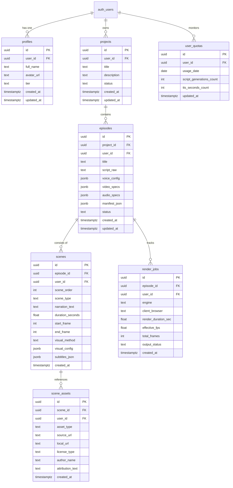

# DATABASE SCHEMA SPECIFICATION & ROW LEVEL SECURITY POLICIES
**Project:** Zero-Budget AI Video Studio (Vietnamese Shorts)  
**Database:** Supabase PostgreSQL (Version 15+)  
**Document ID:** `docs/DATABASE_SCHEMA.md`  
**Security Model:** Mandatory Multi-Tenant Row Level Security (RLS)  

---

## 1. Schema Design Principles

1. **Strict Multi-Tenant Isolation:** Every primary entity is directly bound to a user (`user_id UUID REFERENCES auth.users(id) ON DELETE CASCADE`).
2. **Row Level Security (RLS) Always Enabled:** Every table has RLS enabled (`ALTER TABLE ... ENABLE ROW LEVEL SECURITY;`). No user can read, insert, update, or delete any record where `user_id != auth.uid()`.
3. **Structured Scene Manifest Sync:** The database schema matches the JSON Scene Manifest structure, allowing bidirectional JSON sync and relational querying.
4. **Zero-Cost Optimization:** Indexed foreign keys and composite indexes minimize query compute and storage footprint under Supabase's 500 MB free tier.

---

## 2. Entity Relationship Diagram (ERD)



---

## 3. PostgreSQL DDL & Migration Scripts

```sql
-- ================================================================
-- 1. EXTENSIONS & SETUP
-- ================================================================
CREATE EXTENSION IF NOT EXISTS "uuid-ossp";

-- ================================================================
-- 2. USER PROFILES TABLE
-- ================================================================
CREATE TABLE public.profiles (
    id UUID PRIMARY KEY DEFAULT uuid_generate_v4(),
    user_id UUID NOT NULL UNIQUE REFERENCES auth.users(id) ON DELETE CASCADE,
    full_name TEXT,
    avatar_url TEXT,
    tier TEXT NOT NULL DEFAULT 'free',
    created_at TIMESTAMPTZ NOT NULL DEFAULT timezone('utc'::text, now()),
    updated_at TIMESTAMPTZ NOT NULL DEFAULT timezone('utc'::text, now())
);

ALTER TABLE public.profiles ENABLE ROW LEVEL SECURITY;

CREATE POLICY "Users can view own profile"
    ON public.profiles FOR SELECT
    USING (auth.uid() = user_id);

CREATE POLICY "Users can update own profile"
    ON public.profiles FOR UPDATE
    USING (auth.uid() = user_id);

-- Auto-create profile on signup trigger
CREATE OR REPLACE FUNCTION public.handle_new_user()
RETURNS TRIGGER AS $$
BEGIN
    INSERT INTO public.profiles (user_id, full_name, avatar_url)
    VALUES (NEW.id, NEW.raw_user_meta_data->>'full_name', NEW.raw_user_meta_data->>'avatar_url');
    RETURN NEW;
END;
$$ LANGUAGE plpgsql SECURITY DEFINER;

CREATE OR REPLACE TRIGGER on_auth_user_created
    AFTER INSERT ON auth.users
    FOR EACH ROW EXECUTE FUNCTION public.handle_new_user();

-- ================================================================
-- 3. PROJECTS TABLE
-- ================================================================
CREATE TABLE public.projects (
    id UUID PRIMARY KEY DEFAULT uuid_generate_v4(),
    user_id UUID NOT NULL REFERENCES auth.users(id) ON DELETE CASCADE,
    title TEXT NOT NULL,
    description TEXT,
    status TEXT NOT NULL DEFAULT 'draft',
    created_at TIMESTAMPTZ NOT NULL DEFAULT timezone('utc'::text, now()),
    updated_at TIMESTAMPTZ NOT NULL DEFAULT timezone('utc'::text, now())
);

CREATE INDEX idx_projects_user_id ON public.projects(user_id);
ALTER TABLE public.projects ENABLE ROW LEVEL SECURITY;

CREATE POLICY "Users can CRUD own projects"
    ON public.projects FOR ALL
    USING (auth.uid() = user_id)
    WITH CHECK (auth.uid() = user_id);

-- ================================================================
-- 4. EPISODES TABLE
-- ================================================================
CREATE TABLE public.episodes (
    id UUID PRIMARY KEY DEFAULT uuid_generate_v4(),
    project_id UUID NOT NULL REFERENCES public.projects(id) ON DELETE CASCADE,
    user_id UUID NOT NULL REFERENCES auth.users(id) ON DELETE CASCADE,
    title TEXT NOT NULL,
    script_raw TEXT NOT NULL,
    voice_config JSONB NOT NULL DEFAULT '{"voice": "vi-VN-NamMinhNeural", "rate": "+5%", "pitch": "+0Hz"}'::jsonb,
    video_specs JSONB NOT NULL DEFAULT '{"width": 1080, "height": 1920, "fps": 30}'::jsonb,
    audio_specs JSONB NOT NULL DEFAULT '{"target_lufs": -15.0, "true_peak": -1.2}'::jsonb,
    manifest_json JSONB,
    status TEXT NOT NULL DEFAULT 'draft',
    created_at TIMESTAMPTZ NOT NULL DEFAULT timezone('utc'::text, now()),
    updated_at TIMESTAMPTZ NOT NULL DEFAULT timezone('utc'::text, now())
);

CREATE INDEX idx_episodes_project_id ON public.episodes(project_id);
CREATE INDEX idx_episodes_user_id ON public.episodes(user_id);
ALTER TABLE public.episodes ENABLE ROW LEVEL SECURITY;

CREATE POLICY "Users can CRUD own episodes"
    ON public.episodes FOR ALL
    USING (auth.uid() = user_id)
    WITH CHECK (auth.uid() = user_id);

-- ================================================================
-- 5. SCENES TABLE
-- ================================================================
CREATE TABLE public.scenes (
    id UUID PRIMARY KEY DEFAULT uuid_generate_v4(),
    episode_id UUID NOT NULL REFERENCES public.episodes(id) ON DELETE CASCADE,
    user_id UUID NOT NULL REFERENCES auth.users(id) ON DELETE CASCADE,
    scene_order INT NOT NULL,
    scene_type TEXT NOT NULL DEFAULT 'narrative',
    narration_text TEXT NOT NULL,
    duration_seconds FLOAT NOT NULL DEFAULT 5.0,
    start_frame INT NOT NULL DEFAULT 0,
    end_frame INT NOT NULL DEFAULT 150,
    visual_method TEXT NOT NULL DEFAULT 'photo',
    visual_config JSONB NOT NULL DEFAULT '{}'::jsonb,
    subtitles_json JSONB DEFAULT '[]'::jsonb,
    created_at TIMESTAMPTZ NOT NULL DEFAULT timezone('utc'::text, now())
);

CREATE INDEX idx_scenes_episode_id ON public.scenes(episode_id);
ALTER TABLE public.scenes ENABLE ROW LEVEL SECURITY;

CREATE POLICY "Users can CRUD own scenes"
    ON public.scenes FOR ALL
    USING (auth.uid() = user_id)
    WITH CHECK (auth.uid() = user_id);

-- ================================================================
-- 6. SCENE ASSETS TABLE (License Tracking)
-- ================================================================
CREATE TABLE public.scene_assets (
    id UUID PRIMARY KEY DEFAULT uuid_generate_v4(),
    scene_id UUID NOT NULL REFERENCES public.scenes(id) ON DELETE CASCADE,
    user_id UUID NOT NULL REFERENCES auth.users(id) ON DELETE CASCADE,
    asset_type TEXT NOT NULL, -- 'image', 'video', 'audio', 'svg'
    source_url TEXT NOT NULL,
    local_url TEXT,
    license_type TEXT NOT NULL, -- 'CC0', 'Public Domain', 'CC-BY', 'Pexels'
    author_name TEXT,
    attribution_text TEXT,
    created_at TIMESTAMPTZ NOT NULL DEFAULT timezone('utc'::text, now())
);

CREATE INDEX idx_scene_assets_scene_id ON public.scene_assets(scene_id);
ALTER TABLE public.scene_assets ENABLE ROW LEVEL SECURITY;

CREATE POLICY "Users can CRUD own scene assets"
    ON public.scene_assets FOR ALL
    USING (auth.uid() = user_id)
    WITH CHECK (auth.uid() = user_id);

-- ================================================================
-- 7. RENDER JOBS & AUDIT TABLE
-- ================================================================
CREATE TABLE public.render_jobs (
    id UUID PRIMARY KEY DEFAULT uuid_generate_v4(),
    episode_id UUID NOT NULL REFERENCES public.episodes(id) ON DELETE CASCADE,
    user_id UUID NOT NULL REFERENCES auth.users(id) ON DELETE CASCADE,
    engine TEXT NOT NULL DEFAULT 'webcodecs-client',
    client_browser TEXT,
    render_duration_sec FLOAT,
    effective_fps FLOAT,
    total_frames INT,
    output_status TEXT NOT NULL DEFAULT 'completed',
    created_at TIMESTAMPTZ NOT NULL DEFAULT timezone('utc'::text, now())
);

CREATE INDEX idx_render_jobs_user_id ON public.render_jobs(user_id);
ALTER TABLE public.render_jobs ENABLE ROW LEVEL SECURITY;

CREATE POLICY "Users can view and insert own render jobs"
    ON public.render_jobs FOR ALL
    USING (auth.uid() = user_id)
    WITH CHECK (auth.uid() = user_id);

-- ================================================================
-- 8. USER QUOTAS TABLE (Rate Limiting)
-- ================================================================
CREATE TABLE public.user_quotas (
    id UUID PRIMARY KEY DEFAULT uuid_generate_v4(),
    user_id UUID NOT NULL REFERENCES auth.users(id) ON DELETE CASCADE,
    usage_date DATE NOT NULL DEFAULT CURRENT_DATE,
    script_generations_count INT NOT NULL DEFAULT 0,
    tts_seconds_count INT NOT NULL DEFAULT 0,
    updated_at TIMESTAMPTZ NOT NULL DEFAULT timezone('utc'::text, now()),
    UNIQUE(user_id, usage_date)
);

CREATE INDEX idx_user_quotas_user_date ON public.user_quotas(user_id, usage_date);
ALTER TABLE public.user_quotas ENABLE ROW LEVEL SECURITY;

CREATE POLICY "Users can view own quotas"
    ON public.user_quotas FOR SELECT
    USING (auth.uid() = user_id);
```
