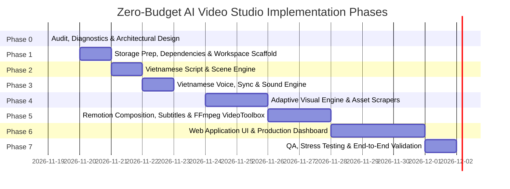

# IMPLEMENTATION ROADMAP & PHASED EXECUTION PLAN
**Project:** Zero-Budget AI Video Studio (Vietnamese Shorts)  
**Document ID:** `docs/IMPLEMENTATION_ROADMAP.md`  
**Date:** 2026-11-19  
**Auditor:** Principal Software Architect & Project Lead  
**Status:** Complete (Phase 0 Audit)

---

## 1. Roadmap Overview & Phased Governance

This roadmap outlines the systematic, phased implementation of the **Zero-Budget AI Video Studio**. 

To protect the host machine (Apple M3, 8GB RAM, 240 MB available storage) from stability risks, the project strictly enforces sequential milestone gates. In strict adherence to **Rule 10 and Rule 11**, Phase 1 will not commence automatically. Implementation will commence only after the user reviews this audit, completes storage prerequisites, and grants explicit approval.



---

## 2. Phase-by-Phase Execution Details

### Phase 0: Audit, Diagnostics & System Architecture (COMPLETED)
* **Status:** 100% Complete.
* **Deliverables:**
  * Complete workspace inspection (`/Users/thienduc/Desktop/Code/ytbshorts`).
  * Deep audit of reference repository (`claude-animated-shorts`).
  * Non-invasive hardware benchmarks (Apple M3, 8GB RAM, MPS Metal, swap analysis, storage audit).
  * 9 comprehensive engineering audit documents created in `docs/`.

---

### Phase 1: Environment & Foundation Setup
* **Prerequisites (User Action Required):**
  1. Free at least **15 GB** of disk space on `/System/Volumes/Data`.
  2. Install FFmpeg: `brew install ffmpeg`.
* **Technical Objectives:**
  * Initialize Git repository with strict `.gitignore` (ignoring `.cache/`, `node_modules/`, `episodes/*/raw_video*`, and swap files).
  * Scaffold directory architecture:
    ```
    ytbshorts/
    ├── backend/           # FastAPI application, API routers, WebSocket manager
    ├── frontend/          # React 19 / Vite web dashboard
    ├── engine/            # Modular Python & Node.js processing engines
    │   ├── script/        # Vietnamese NLP & Scene Manifest builder
    │   ├── voice/         # TTS providers & word alignment
    │   ├── audio/         # Procedural DSP synthesizer & mixer
    │   ├── visual/        # Asset downloaders & procedural generators
    │   └── render/        # Remotion compositions & VideoToolbox exporter
    ├── templates/         # Adapted reference assets (dsp.py, toon Pen, short_qa.py)
    ├── episodes/          # Isolated episode projects
    ├── docs/              # Architectural documentation
    └── .cache/            # Managed temporary cache (REMOTION_TMP)
    ```
  * Create `package.json` with pinned Remotion, React, and Three.js dependencies.
  * Create `requirements.txt` with pinned FastAPI, Edge-TTS, and Scipy packages.
  * Create system health-check script (`engine/check_env.py`).

---

### Phase 2: Vietnamese Script & Scene Engine
* **Technical Objectives:**
  * Implement `VietnameseSegmenter`: Rule-based NLP splitter tailored to Vietnamese grammar, counting syllables and estimating scene durations.
  * Implement target pacing calculator enforcing the **3.8 to 4.4 syllables/second** documentary standard.
  * Implement Pydantic `SceneManifest` schema ensuring type-safe serialization of `manifest.json`.
  * Build template library for narrative story structures: Hook -> Setting -> Escalation -> Mechanism -> Twist.

---

### Phase 3: Vietnamese Voice, Sync & Sound Design Engine
* **Technical Objectives:**
  * Implement `EdgeTTSProvider` with support for `vi-VN-NamMinhNeural` and `vi-VN-HoaiMyNeural`, parsing WebSocket `WordBoundary` telemetry into `words.json`.
  * Implement `MacOSTTSProvider` (`say -v Linh`) with Whisper Base fallback alignment for 100% offline environments.
  * Port and parameterize the reference DSP audio suite (`templates/audio/dsp.py`, `instruments.py`, `sfx_gen.py`, `mix.py`).
  * Implement automated voice-over ducking (`-3.5 dB`) and master normalization to `-15.0 LUFS` / True Peak `≤ -1.2 dBTP`.
  * Generate standardized `subtitles.srt` with millisecond-accurate word intervals.

---

### Phase 4: Adaptive Visual Engine & Compliance Scraper
* **Technical Objectives:**
  * Implement public asset scrapers with license verification filters:
    * `WikimediaScraper`: CC0 and Public Domain historical media.
    * `OpenverseScraper`: Creative Commons cultural imagery.
    * `PexelsScraper`: Permissive high-definition video clips.
    * `MapTileFetcher`: Vector map tiles from OpenStreetMap.
  * Implement image downscaler and preprocessor: automatically crops, scales to 1080×1920, and applies warm Day / Golden grading LUTs.
  * Adapt reference `toon.ts` `Pen` vector drawing class into a standalone procedural illustration engine.
  * Implement Automated Attribution Generator: writes verified source URLs, creators, and license tags to `ATTRIBUTION.md`.

---

### Phase 5: Remotion Rendering & VideoToolbox Pipeline
* **Technical Objectives:**
  * Build root Remotion composition (1080 × 1920 portrait, 30 FPS).
  * Build dynamic `SceneDispatcher` component routing scenes to:
    * `PhotoScene` (Ken Burns smootherstep panning).
    * `StockScene` (Color-graded B-roll).
    * `ArchivalScene` (Duotone historical documents).
    * `MapScene` (Animated travel paths).
    * `SVGScene` / `InfographicScene` (Dynamic animated counters).
    * `ParallaxScene` (2.5D multi-plane depth).
    * `ToonScene` (Three.js billboard cartoon figures).
  * Implement animated vertical subtitle component with active-word yellow bounce styling (`#FFDF00` scale `1.15x`).
  * Integrate Apple Silicon hardware-accelerated video multiplexer via FFmpeg (`h264_videotoolbox`).
  * Integrate `short_qa.py` to automatically detect black frames, pops, audio clipping, and subtitle overflow.

---

### Phase 6: Web Application & Production Dashboard
* **Technical Objectives:**
  * Build FastAPI backend providing REST endpoints:
    * `POST /api/episodes`: Create new episode from Vietnamese script.
    * `GET /api/episodes/{id}`: Fetch episode manifest.
    * `POST /api/episodes/{id}/render`: Trigger staged video render.
    * `POST /api/episodes/{id}/scenes/{scene_id}/regenerate`: Partial scene re-render.
  * Build WebSocket server streaming real-time pipeline progress and log output to the UI.
  * Build React / Vite frontend with:
    * `ScriptStudio`: Input script, select tone, set target duration.
    * `StoryboardEditor`: Visual scene cards with narration, asset preview, and visual method selector.
    * `LiveProgressModal`: Interactive progress ring and live stage notifications.
    * `VideoPlayer`: HTML5 video player with stem toggles (Voice, Music, SFX, Master) and direct download buttons (MP4, SRT, WAV).
    * `EpisodeHistory`: Browse and duplicate past productions.

---

### Phase 7: Quality Assurance, Hardening & Final Benchmarking
* **Technical Objectives:**
  * Conduct full end-to-end dry run: Produce a complete 65-second Vietnamese documentary short from a raw script.
  * Benchmark total memory consumption under full rendering load to confirm adherence to the 1.5 GB RAM studio budget.
  * Verify zero monetary cost across the entire lifecycle.
  * Confirm that all output files conform to YouTube Shorts and TikTok upload specifications.

---

## 3. Risk Management & Contingency Matrix

| Risk Factor | Probability | Impact | Mitigation Strategy |
| :--- | :--- | :--- | :--- |
| **Disk Space Exhaustion (`ENOSPC`)** | High | Fatal | Block Phase 1 until user frees 15 GB; enforce immediate bundle cleanup after renders. |
| **Out-of-Memory Freeze (8GB RAM)** | High | Severe | Restrict Remotion concurrency to `1`; enforce strict staged execution with zero task overlap. |
| **Edge-TTS Cloud Interruption** | Low | Moderate | Automatic fallback to native offline macOS `say -v Linh` speech engine. |
| **Fanless Thermal Throttling** | Medium | Low | Encode strictly via Apple Silicon hardware ASIC (`h264_videotoolbox`), bypassing CPU encoders. |
| **Asset Copyright Infringement** | Medium | Severe | Reject all media lacking explicit CC0, Public Domain, or Pexels permissive licenses. |
| **Vietnamese Diacritic Display Bug** | Low | Moderate | Standardize on Google Font `Be Vietnam Pro` (SIL OFL) with full UTF-8 encoding. |

---

## 4. Required Technical Distinctions

### Verified Facts
1. All 9 required Phase 0 audit documents have been drafted and saved to `docs/`.
2. Workspace remains completely unpolluted: zero dependencies installed, zero code files modified, zero files deleted.
3. Node.js 24, Python 3.9, and PyTorch with MPS are operational.
4. FFmpeg is missing and disk storage is exhausted (240 MB free).

### Technical Assumptions
1. Following user disk cleanup and FFmpeg installation, Phase 1 through Phase 7 can be executed incrementally without hardware blocks.
2. The modular architecture will allow independent testing of audio, script, and visual components before Remotion integration.

### Proposed Solutions
1. Halt Phase 0 immediately and present the final comprehensive audit report to the user.
2. Provide clear instructions for user prerequisites (disk cleanup, FFmpeg) to prepare for Phase 1.

### Known Limitations
1. Phase 1 cannot proceed until the user clears disk storage.

### Unresolved Questions
1. Does the user approve this phased implementation roadmap?
