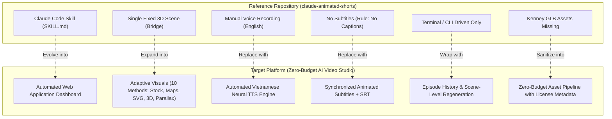

# REPOSITORY AUDIT & CODEBASE INSPECTION REPORT
**Project:** Zero-Budget AI Video Studio (Vietnamese Shorts)  
**Document ID:** `docs/REPOSITORY_AUDIT.md`  
**Date:** 2026-11-19  
**Auditor:** Principal Software Architect & Systems Engineer  
**Status:** Complete (Phase 0 Audit)

---

## 1. Executive Summary

This document presents a comprehensive, evidence-based audit of both the local workspace (`/Users/thienduc/Desktop/Code/ytbshorts`) and the target reference repository ([claude-animated-shorts](https://github.com/mromidev/claude-animated-shorts)). 

The objective of this audit is to evaluate existing assets, extract reusable architectural patterns, identify architectural deficits relative to the "Zero-Budget AI Video Studio" requirements, and establish the technical baseline required to build a reusable, automated web application for producing Vietnamese educational Shorts on an Apple Silicon M3 (8GB RAM) workstation.

---

## 2. Local Workspace Audit (`ytbshorts`)

### 2.1 Workspace Status & Environment Verification
An exhaustive non-invasive scan of `/Users/thienduc/Desktop/Code/ytbshorts` was executed.

* **Directory State:** The directory `/Users/thienduc/Desktop/Code/ytbshorts` was empty.
* **Version Control:** Git was not initialized in this directory.
* **Operating System:** macOS 26.0 (Darwin Kernel Version 25.0.0: Mon Aug 25 21:17:36 PDT 2025; arm64).
* **Hardware Architecture:** Apple M3, 8,589,934,592 bytes (8.00 GB) unified memory.
* **Node.js Runtime:** Node.js `v24.22.3` located at `/opt/homebrew/opt/node@24/bin/node`.
* **NPM Runtime:** NPM `11.19.1` located at `/opt/homebrew/opt/node@24/bin/npm`.
* **Python Runtime:** Python `3.9.6` located at `/usr/bin/python3`.
* **PyTorch & Acceleration:** PyTorch `2.8.0` is installed. Verification script confirmed Apple Metal Performance Shaders (MPS): `torch.backends.mps.is_available() == True` and `torch.backends.mps.is_built() == True`.
* **Installed Python Packages:** `numpy 1.26.4`, `scipy 1.13.1`, `pillow 11.3.0`, `opencv-python 4.11.0.86`, `fastapi 0.128.8`, `uvicorn 0.39.0`, `pydantic 2.13.5`, `httpx 0.28.1`, `websockets 15.0.1`, `psutil 7.2.2`.
* **Homebrew Formulae:** Homebrew is installed at `/opt/homebrew/bin/brew`. Currently installed formulae include `node@24`, `go`, `sqlite`, `openssl@4`, `zstd`, `lz4`, `icu4c@79`, `brotli`.
* **FFmpeg Status:** `ffmpeg not found` in the system path (`/usr/bin`, `/opt/homebrew/bin`). FFmpeg is a mandatory binary for Remotion video encoding, audio muxing, and quality control.
* **macOS Built-in Speech Voices:** Querying system speech voices revealed that `Linh (Tiếng Việt (Việt Nam)) vi_VN` is installed natively on the system.
* **Storage & Memory Constraints (Critical):**
  * `vm.swapusage`: `total = 4608.00M, used = 4185.62M, free = 422.38M`. The system is actively experiencing high memory pressure with 4.18 GB of swap allocated on disk.
  * `df -h /System/Volumes/Data`: **Only 240 MB available disk space** (`188Gi used / 228Gi total`, 100% capacity). This is a critical physical bottleneck that dictates strict zero-disk-bloat policies.

---

## 3. Reference Repository Audit (`claude-animated-shorts`)

The reference repository was cloned into an isolated inspection environment (`/tmp/claude-animated-shorts-audit`) via `git clone --depth 1 https://github.com/mromidev/claude-animated-shorts`.

### 3.1 Repository Identity & Architecture Nature
* **Repository Type:** The repository is **not** a standalone web application, nor is it an executable Node.js project. It does **not** contain a root `package.json`, `tsconfig.json`, or automated build script.
* **Nature:** It is a **Claude Code Skill package** (`SKILL.md`) structured to be copied into `~/.claude/skills/cartoon-3d-short/` and operated interactively via conversational prompts with an AI agent.
* **Target Video Reference:** It was built and tuned for a single 67-second English short film titled *"The Bridge That Fell for a Song"* (documenting the 1831 Broughton suspension bridge collapse).
* **Licensing:** The repository root contains an MIT License (`LICENSE`) dated 2026. However, reference visual assets inside `references/frames/` and `references/sheets/` are explicitly designated for private study only.

### 3.2 Directory Structure & Component Inventory
```
claude-animated-shorts/
├── LICENSE                    # MIT License for code and documentation
├── README.md                  # Skill overview and installation manual
├── SKILL.md                   # Full operational prompt & pipeline instructions
├── references/
│   ├── STYLE_BIBLE.md         # Script and visual formula measured from 20 shorts
│   ├── frames/                # 38 extracted reference frames (540x960)
│   ├── sheets/                # 20 contact sheets (60 frames each = 1,200 frames)
│   └── reports/               # 7 empirical measurement reports:
│       ├── CONTEXT.md         # Shared agent brief & baseline stack
│       ├── characters.md      # Character anatomy, facial geometry, bean head specs
│       ├── depth.md           # Depth-of-field, camera focus, bloom, fog
│       ├── grade.md           # Color grading, tone mapping, luma/chroma targets
│       ├── lighting.md        # Day/Golden light presets, azimuth, elevation
│       ├── motion.md          # Camera smootherstep curves, speeds, hold push-ins
│       ├── outlines.md        # Edge detection, ink thickness, creases
│       └── textures.md        # Procedural canvas textures vs model materials
└── templates/
    ├── SCRIPT_example.md      # Example script breakdown with factual references
    ├── sandbox_index_example.tsx # Remotion composition entry snippet
    ├── audio/                 # Python DSP audio synthesis suite
    │   ├── cues.md            # Timing cues documentation
    │   ├── dsp.py             # Core DSP utilities (filters, LUFS, True Peak)
    │   ├── instruments.py     # Synthesized instruments (brass, snare, flute)
    │   ├── mix.py             # Stem mixing, ducking, master limiter
    │   ├── music.py           # Procedural march music generator
    │   ├── sfx.py             # Sound effect dispatcher
    │   ├── sfx_gen.py         # Procedural sound effect generators
    │   └── timeline.py        # Audio beat timeline and shot mapping
    ├── bridge/                # Remotion + Three.js source code for the Bridge short
    │   ├── Bridge.tsx         # Root composition, EffectComposer, render pipeline
    │   ├── build.ts           # 3D town geometry, procedural houses, GLB loader
    │   ├── cardshade.ts       # Billboard lighting and shadow shaders
    │   ├── cast.ts            # Dynamic sprite billboard pool and actor manager
    │   ├── grade.ts           # Custom postprocessing color grading pass
    │   ├── ink.ts             # World outline postprocessing shader pass
    │   ├── lensblur.ts        # Thin-lens depth-of-field shader pass
    │   ├── lights.ts          # Directional sun, hemisphere, and fog presets
    │   ├── paint.ts           # Procedural Canvas2D texture generator (brick, wood, stone)
    │   ├── shade.ts           # Two-tone cartoon cel shader
    │   ├── story.ts           # Shot list, camera keys, physics state, beat timing
    │   ├── toon.ts            # Canvas2D vector character illustration engine (Pen class)
    │   └── world.ts           # Three.js scene assembly, bridge deformation physics
    └── scripts/               # Production QA and automation scripts
        ├── bridge-stills.mjs  # Fast still frame renderer
        ├── bridge_merge.py    # Sandbox file merger
        ├── bridge_shots.py    # Shot JSON exporter
        ├── sbs_sheet.py       # Side-by-side QA image comparator
        └── short_qa.py        # Frame-by-frame automated visual/audio QA
```

---

## 4. Subsystem Technical Analysis

### 4.1 Rendering Engine (`templates/bridge/Bridge.tsx`)
* **Technology:** Remotion 4.0 (`@remotion/three`, `@react-three/fiber`, `@react-three/postprocessing`, `three 0.175`, `postprocessing 6.37`).
* **Composition:** Configured at 1080 × 1920 (9:16 vertical), 30 FPS.
* **Post-Processing Chain Order:**
  1. `InkPass`: Screen-space depth/normal edge detection rendering dark world ink lines.
  2. `LensBlur (pre + main)`: Thin-lens depth of field based on camera target distance.
  3. `Bloom`: Emissive-only bloom with a 6-level MIP chain.
  4. `ToneMapping`: Three.js Neutral tone mapping.
  5. `GradeEffect`: Custom color grading matrix for Day and Golden Hour modes.
  6. Multisampling: MSAA 4.
* **Evaluation:** Highly sophisticated visual pipeline producing genuine cartoon-in-3D aesthetics. However, running Remotion with Three.js WebGL canvases and multi-pass post-processing requires significant GPU and memory resources.

### 4.2 Character Illustration & Animation Engine (`templates/bridge/toon.ts` & `cast.ts`)
* **Technology:** Pure HTML5 Canvas2D rendering via a custom `Pen` class.
* **Rendering Principle:** Does not use 3D character meshes or skeletal rigs. Instead, it procedurally draws 2D cartoon figures (bean heads, stick limbs, costumes, facial expressions) onto dynamic `<canvas>` elements at runtime.
* **Billboard Architecture (`cast.ts`):** Dynamic canvas buffers are converted to `THREE.CanvasTexture` instances and mapped to camera-facing 3D quad billboards (`Pool` class). Identical characters marching or standing in synchronization share canvas textures to conserve memory.
* **Evaluation:** Brilliant zero-budget 2D/3D hybrid technique. Avoids complex 3D rigging, consumes zero external asset bandwidth, and provides distinct hand-drawn styling.

### 4.3 World & Environment Engine (`templates/bridge/world.ts` & `build.ts`)
* **Procedural Buildings:** Houses and walls are procedural Three.js `BoxGeometry` meshes with custom Canvas2D procedural textures generated on the fly (`paint.ts` creates bricks, roof tiles, wood planks, cobblestone).
* **Missing Assets Discovered:** In `world.ts`, the function `loadKit()` attempts to load 26 low-poly Kenney 3D assets (`staticFile("bridge/kenney/${n}.glb")` such as `tree_oak`, `windmill`, `cart`). **These GLB files are not included in the repository.** The repository relies on external CC0 Kenney assets that were expected to be manually downloaded into a `public/` directory.

### 4.4 Audio Synthesis & Sound Design (`templates/audio/`)
* **Technology:** 100% Python-based mathematical audio synthesis using `numpy` and `scipy.signal`.
* **Method:** Rather than utilizing pre-recorded commercial sound effect packs, it generates brass instruments, drums, snares, whistling, snaps, groans, splashes, and tension drones by modulating sine waves, noise generators, and physical modeling filters (`dsp.py`, `instruments.py`, `sfx_gen.py`).
* **Mastering & Mixing (`mix.py`):** Implements dynamic voice-over ducking (-3 dB), stem caching, integrated loudness mastering to `-15.0 LUFS`, and an oversampled look-ahead peak limiter enforcing True Peak `≤ -1.2 dBTP`.
* **Evaluation:** Completely zero-budget, zero-licensing-risk audio engine. Highly reusable for sound effects and procedural tension music.

### 4.5 Quality Control System (`templates/scripts/short_qa.py`)
* **Technology:** Python with `ffmpeg`, `ffprobe`, `numpy`, and `Pillow`.
* **Capabilities:**
  * Validates frame dimensions, exact framerate, duration, and audio stream properties.
  * Measures EBU R128 integrated loudness, loudness range (LRA), and True Peak.
  * Runs silence detection (`silencedetect`).
  * Decodes raw RGB24 video frames to inspect per-frame luma, chroma saturation, and inter-frame difference metrics.
  * Automatically flags black frames, unplanned white frames, frozen holds (`diff < 0.02` for `≥ 12` frames), and visual pops (diff spike `> 3x` local median).
  * Generates 2-second visual contact sheets (60 frames each) with frame numbers burned in.
* **Evaluation:** Production-grade QA script. Can be directly incorporated into the new studio engine.

### 4.6 Localization & Accessibility Deficits
* **Voice-over:** The reference pipeline has **zero Vietnamese support**. `SKILL.md` explicitly specifies: *"English only"*, *"Voice: one steady tone"*, and requires manual generation and hand-fixing of `words.json`.
* **Subtitles:** The reference pipeline explicitly enforces: *"No captions or labels in the video"*. It has no subtitle generation, no SRT parser, and no animated text rendering components.

---

## 5. Reusability Assessment

| Component | Status | Adaptation Required |
| :--- | :--- | :--- |
| **`templates/scripts/short_qa.py`** | **Reusable As-Is** | Minimal; add subtitle collision and aspect ratio sanity checks. |
| **`templates/audio/dsp.py` & `mix.py`** | **Reusable As-Is** | Parameterize durations and loudness targets; adapt input paths. |
| **`templates/bridge/toon.ts` (Pen class)** | **Reusable with Adaptation** | Extract core drawing primitives (`Pen`, superellipse, limbs) into an abstract SVG/Canvas illustration library. |
| **`templates/bridge/cardshade.ts` & `ink.ts`** | **Reusable with Adaptation** | Shader code can be reused inside Remotion Three.js compositions. |
| **`templates/audio/sfx_gen.py`** | **Reusable with Adaptation** | Expand procedural sound library beyond historical bridge effects to modern documentary SFX (whooshes, risers, clicks). |
| **`templates/bridge/world.ts` & `build.ts`** | **Major Rework Required** | Currently hardcoded for 1831 Broughton bridge; must be generalized into a dynamic scene graph. |
| **`SKILL.md` Workflow** | **Major Rework Required** | Convert manual Claude interactive prompts into an automated Python/Node state machine. |
| **Web Application Dashboard** | **Completely Missing** | Must build frontend UI (Script editor, Storyboard, Preview, Episode Manager). |
| **Vietnamese TTS & Word Alignment** | **Completely Missing** | Must implement local/free Vietnamese neural voice-over and timing generator. |
| **Subtitle Engine** | **Completely Missing** | Must build dynamic, animated vertical subtitle renderer with Vietnamese diacritic support. |
| **Adaptive Visual Engine** | **Completely Missing** | Must build multi-modal visual selector (Stock, Archival, Maps, SVG, Parallax). |

---

## 6. Structural Discrepancies: Reference vs Product Vision



---

## 7. Required Technical Distinctions

### Verified Facts
1. The workspace `/Users/thienduc/Desktop/Code/ytbshorts` is clean and unpopulated.
2. The reference repository does not contain a runnable web application or `package.json`. It is a Claude Code skill.
3. The reference repository's 3D environment depends on external Kenney CC0 GLB files that are absent from the git tree.
4. Python 3.9.6, Node.js 24.22.3, and PyTorch 2.8.0 with Metal (MPS) support are pre-installed on this machine.
5. macOS native Vietnamese voice `Linh` is installed and verified operational via `say -v Linh`.
6. The host system has severe disk exhaustion: **only 240 MB available on `/System/Volumes/Data`**.
7. The host system has 4.18 GB of swap active, indicating high memory pressure on the 8GB unified memory.
8. `ffmpeg` is not currently installed in the system PATH.

### Technical Assumptions
1. Freeing disk space (at least 15–20 GB) is a mandatory user action before Phase 1 dependencies (Node modules, FFmpeg, asset caches) can be installed.
2. Remotion and Three.js can run on Node 24 on Apple Silicon provided native build tools or pre-compiled binaries are compatible.
3. The Canvas2D procedural illustration technique from `toon.ts` can be decoupled from Three.js and rendered directly into Remotion 2D compositions or SVG, reducing GPU memory footprint.

### Proposed Solutions
1. Build a decoupled, modular system: A lightweight FastAPI/Python backend coordinating workflow tasks, paired with a modern React/Vite web frontend.
2. Incorporate the proven mathematical DSP audio algorithms (`mix.py`, `dsp.py`) and QA script (`short_qa.py`) from the reference repository into the Core Engine.
3. Introduce an **Adaptive Visual Engine** supporting 10 distinct visual types, preventing every scene from requiring a heavy 3D WebGL context.
4. Implement an isolated **Scene Manifest architecture** (`manifest.json`) storing scene timing, narration, visual mode, and asset licenses per episode.

### Known Limitations
1. Without FFmpeg installed, video muxing and frame-accurate QA cannot execute.
2. With 240 MB free disk space, installing `node_modules` for Remotion (~300–500 MB) will immediately trigger an `ENOSPC` disk error.
3. With 8GB total RAM and existing swap pressure, running heavy local neural generation models (Stable Diffusion, ComfyUI, 7B LLMs) simultaneously with Remotion is impossible without kernel out-of-memory crashes.

### Unresolved Questions
1. When will the user perform disk cleanup to grant the necessary working storage (~15–20 GB)?
2. Does the user prefer installing FFmpeg via Homebrew (`brew install ffmpeg`) or placing a portable static FFmpeg binary in the project tools folder?
3. Which Vietnamese voice persona is preferred: the zero-network macOS native `Linh` voice or the studio-quality neural voices from Microsoft Edge-TTS (`vi-VN-HoaiMyNeural` / `vi-VN-NamMinhNeural`)?
