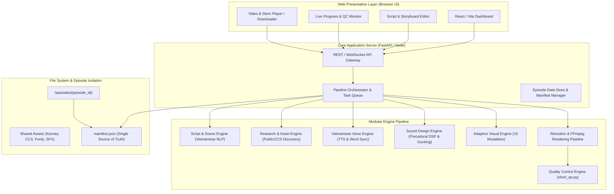

# TECHNICAL ARCHITECTURE & SYSTEM DESIGN
**Project:** Zero-Budget AI Video Studio (Vietnamese Shorts)  
**Document ID:** `docs/TECHNICAL_ARCHITECTURE.md`  
**Date:** 2026-11-19  
**Auditor:** Principal Software Architect & Systems Engineer  
**Status:** Complete (Phase 0 Design)

---

## 1. System Vision & Architectural Principles

The **Zero-Budget AI Video Studio** is an autonomous, local-first desktop web platform designed to transform raw Vietnamese narrative scripts into polished, broadcast-quality vertical shorts (1080 × 1920, 30 FPS, 55–70s) without monetary cost, recurring subscriptions, or commercial API dependencies.

### Core Architectural Principles
1. **Local-First & Zero-Cost:** The core pipeline runs locally on Apple Silicon without mandatory external subscription gates. Public zero-cost APIs with traceable licensing may augment local assets.
2. **Strict Episode Isolation:** Every video production project is encapsulated in an isolated directory containing its own script, assets, audio stems, Scene Manifest, and rendered artifacts. Shared engine code is read-only during production runs.
3. **Modular Decoupling:** The UI, Orchestrator, Script Engine, Visual Engine, Audio Engine, and Rendering Engine communicate via explicit contracts (REST / WebSocket / JSON Manifests), enabling independent testing, replacement, and caching.
4. **Adaptive Visuals:** Rather than forcing every scene into a heavy 3D WebGL world or a generic slideshow, the system dynamically selects the optimal visual format for each scene (photographs, stock footage, historical archives, vector maps, SVG, infographics, procedural graphics, 2.5D parallax, or cartoon billboards).
5. **Memory-Conscious Staging:** In respect of the 8GB unified memory ceiling, heavy tasks (NLP script analysis, asset downloading, voice synthesis, Remotion rendering, and FFmpeg encoding) execute sequentially in pipeline phases, never concurrently.

---

## 2. Global System Architecture



---

## 3. Subsystem Specifications

### Module A: Web Application Layer
* **Frontend Framework:** React 19 / Vite with Tailwind CSS.
* **Component Architecture:**
  * `ScriptInputView`: Text area for Vietnamese script, topic tagging, pace control, tone selection.
  * `StoryboardView`: Interactive grid displaying scenes parsed from the manifest. Allows editing narration text, changing visual method, uploading manual asset overrides, and triggering single-scene re-renders.
  * `ProductionDashboard`: Real-time WebSocket event listener rendering progress bars, step descriptions, and live log streaming.
  * `VideoPreview`: HTML5 video player with subtitle toggles, audio stem switching (voice, BGM, SFX, master), and direct download links (MP4, SRT, WAV).
  * `EpisodeHistory`: Browse, duplicate, or inspect past productions stored in the local episode library.

### Module B: AI Orchestrator & Pipeline State Machine
* **Technology:** Asynchronous Python (FastAPI / asyncio worker) or Node.js pipeline runner.
* **Responsibilities:**
  * Executes the sequential state machine:
    `INIT -> ANALYZE_SCRIPT -> RESEARCH -> GENERATE_VOICE -> TIMING_SYNC -> ASSET_RETRIEVAL -> COMPOSITING -> SOUND_MIX -> RENDER -> QUALITY_CONTROL -> READY`.
  * Manages scene-level caching: If scene 3 is modified, only scene 3's audio and visual assets are recomputed, followed by a lightweight video re-mux.
  * Captures process errors, logs exceptions, and manages retries without halting the host server.

### Module C: Research & Fact-Checking Engine
* **Purpose:** Queries open public repositories to verify script facts and source legitimately reusable visual and audio media.
* **Sources:**
  * Wikimedia Commons API (Public domain & CC-BY historical imagery).
  * Openverse API (Open-licensed creative assets).
  * OpenStreetMap / Overpass API (Geographical vector boundaries and static map tiles).
  * Pexels / Pixabay public APIs (Curated high-resolution stock video and photo clips under permissive platform licenses).
* **Compliance Tracker:** Automatically parses and logs author name, source URL, license type, and attribution requirements into the Scene Manifest.

### Module D: Script & Scene Engine (Vietnamese Specialization)
* **Vietnamese Syllable & Pace Analysis:**
  * Vietnamese speech pacing differs from English. English averages ~3.5–4.0 words/s; Vietnamese is a monosyllabic, tonal language where speaking rates typically average **3.8 to 4.4 syllables/second** in short-form fast-paced narratives.
  * The engine calculates target sentence lengths to ensure scenes land within the **3.0 to 6.5 second** per-scene documentary window.
* **Scene Decomposition:** Splits narrative into:
  1. *Hook* (0–5s): Provocative question or paradoxical historical fact.
  2. *Setting & Inciting Incident* (5–15s): Time, place, named subjects.
  3. *Escalation & Conflict* (15–35s): Three escalating beats with visual evidence.
  4. *The Turn / Mechanism* (35–50s): Explaining the underlying truth or scientific law using an intuitive analogy.
  5. *Climax & Twist Ending* (50–65s): Ironic payoff or unexpected historical consequence.

### Module E: Adaptive Visual Engine
The Adaptive Visual Engine dispatches each scene to one of 10 supported rendering modules:
1. `PhotoScene`: High-resolution photograph with animated Ken Burns pan/zoom, subtle 35mm film grain overlay, and depth vignette.
2. `StockVideoScene`: Royalty-free B-roll stock footage scaled, color-matched, and stabilized.
3. `ArchivalScene`: Historical document or vintage photo with desaturated duotone/sepia grade, vignette, and animated paper texture.
4. `MapScene`: Vector-based geographical visualization (OpenStreetMap / MapLibre) rendering animated routes, coordinate pins, and territory highlights.
5. `SVGScene`: Clean 2D vector illustrations with animated stroke draws, morphing paths, and dynamic color injection.
6. `InfographicScene`: Data-driven animated elements (numerical counters, progress rings, side-by-side comparison cards).
7. `Procedural2DScene`: Canvas2D particle dynamics, speed lines, shockwaves, or abstract motion graphics.
8. `ParallaxScene`: 2.5D multi-plane composition where a subject is segmented from its background, moving at different relative camera velocities.
9. `ToonBillboardScene`: The adapted Three.js + Canvas2D `toon.ts` cartoon character billboard pipeline inherited from the reference design.
10. `LocalAIScene`: Generates custom illustrative imagery when local hardware allows or when external zero-cost generation hooks are configured.

### Module F: Vietnamese Voice Engine
* **Speech Synthesis:** Evaluates and interfaces with:
  * *Option A (100% Offline):* macOS native speech synthesizer (`say -v Linh`).
  * *Option B (High Quality Zero-Cost):* Microsoft Edge TTS (`vi-VN-HoaiMyNeural` / `vi-VN-NamMinhNeural`).
  * *Option C (Local Neural ONNX):* Piper TTS Vietnamese model.
* **Word Timing & Alignment:**
  * Captures word-level start/end timestamps from Edge TTS WebSocket telemetry or via a local Whisper Base/Tiny model running on Apple MPS.
  * Generates synchronized `words.json` and `subtitles.srt` mapping exact millisecond boundaries for subtitle animation.

### Module G: Sound Design Engine
* **Inherited from Reference:** Integrates the proven DSP audio pipeline (`dsp.py`, `instruments.py`, `sfx_gen.py`, `mix.py`).
* **Procedural Synthesis:** Synthesizes custom rhythmic march drums, tension risers, impact thuds, and whooshes directly in Python using `numpy`/`scipy`.
* **Automated Stem Mixing:**
  * Voice stem normalized and placed at center.
  * Music stem automatically ducked by `-3.0 dB` to `-4.5 dB` under vocal syllables based on `words.json` timing.
  * SFX stem positioned precisely 0–2 frames before dramatic visual beats.
  * Master loudness mastered to `-14.0 LUFS` to `-15.0 LUFS` with True Peak clamped to `≤ -1.2 dBTP`.

### Module H: Rendering Engine (Remotion & FFmpeg)
* **Remotion Composition:**
  * 1080 × 1920 portrait canvas at 30 FPS.
  * Dynamic composition assembling scenes from `manifest.json`.
  * Animated Subtitles: Rendered using React Spring or Remotion interpolations with word-by-word active highlight styling.
* **FFmpeg Pipeline:**
  * Uses macOS hardware-accelerated H.264 encoder (`h264_videotoolbox`) for fast, power-efficient export.
  * Audio multiplexing combines the silent Remotion video stream with the finalized mastered `mix.wav`.

### Module I: Quality Control Engine
* **Integration of `short_qa.py`:** Runs an automated frame-by-frame diagnostic check post-render:
  * Detects black or dropped frames.
  * Detects accidental frozen visual spans (`≥ 12` frames).
  * Verifies EBU R128 audio loudness compliance.
  * Checks for subtitle overflow against 9:16 mobile safe zone boundaries (100px margins, UI-safe bottom buffer).
  * Emits `qa_report.json` and 2-second visual contact sheets.

---

## 4. Structured Scene Manifest Schema

The `manifest.json` file is the sole contract between engines and enables scene-level caching and regeneration.

```json
{
  "episode_id": "ep_20261119_001",
  "title": "Bí Ẩn Cầu Broughton",
  "version": "1.0.0",
  "created_at": "2026-11-19T14:40:00Z",
  "audio_specs": {
    "sample_rate": 48000,
    "channels": 2,
    "target_lufs": -15.0,
    "true_peak_limit": -1.2
  },
  "video_specs": {
    "width": 1080,
    "height": 1920,
    "fps": 30,
    "total_frames": 1800,
    "duration_seconds": 60.0
  },
  "voice_config": {
    "engine": "edge-tts",
    "voice_name": "vi-VN-NamMinhNeural",
    "pitch": "+0Hz",
    "rate": "+5%"
  },
  "scenes": [
    {
      "scene_id": "scene_01",
      "index": 1,
      "type": "hook",
      "start_frame": 0,
      "end_frame": 150,
      "duration_seconds": 5.0,
      "narration_text": "74 người lính đã đánh sập một cây cầu sắt chỉ bằng cách... bước đều.",
      "visual_method": "parallax",
      "visual_config": {
        "subject_image": "assets/soldiers_cutout.png",
        "background_image": "assets/bridge_bg.jpg",
        "camera_motion": "slow_push_in",
        "motion_intensity": 1.2,
        "lighting_preset": "day"
      },
      "assets": [
        {
          "asset_id": "asset_01",
          "file_path": "assets/bridge_bg.jpg",
          "source_url": "https://commons.wikimedia.org/wiki/File:Broughton_Bridge.jpg",
          "license": "Public Domain (CC0)",
          "author": "Archival Collection"
        }
      ],
      "sound_design": {
        "sfx_cues": [
          { "frame": 30, "type": "sub_thud", "volume": 0.8 },
          { "frame": 120, "type": "snap_wood", "volume": 1.0 }
        ],
        "music_bed": "march_rhythm_intro"
      },
      "subtitles": [
        { "start_ms": 100, "end_ms": 600, "word": "74" },
        { "start_ms": 650, "end_ms": 1100, "word": "người lính" },
        { "start_ms": 1150, "end_ms": 1800, "word": "đánh sập" }
      ],
      "render_status": {
        "audio_cached": true,
        "visual_cached": false,
        "last_rendered": null
      }
    }
  ]
}
```

---

## 5. Required Technical Distinctions

### Verified Facts
1. The reference repository's modular Three.js code (`Bridge.tsx`, `world.ts`, `toon.ts`) and audio suite (`mix.py`, `dsp.py`) are highly structured and cleanly written, but tightly coupled to a single hardcoded scene ("Bridge").
2. The host machine has FastAPI, Uvicorn, PyTorch with MPS, Scipy, NumPy, Pillow, OpenCV, and WebSockets pre-installed.
3. Apple Metal (MPS) is operational for accelerated local ML tensor computations.
4. The host machine's swap utilization is 4.18 GB, and remaining storage is only 240 MB, precluding large parallel workers.

### Technical Assumptions
1. Decoupling the rendering pipeline into 10 visual methods will drastically reduce average frame rendering times, as SVG and 2D Parallax render at 30–60 FPS, compared to Three.js WebGL + 6-pass post-processing which runs at ~4 FPS.
2. A single local web server (FastAPI) can serve both the REST API, WebSocket progress notifications, and static video preview assets on `localhost:8000`.
3. Standard 9:16 vertical video mobile safe zones require captions to be positioned between `60%` and `78%` of total frame height to avoid UI overlay collisions on YouTube Shorts and TikTok.

### Proposed Solutions
1. Build the AI Orchestrator as a lightweight Python state machine managing the pipeline steps sequentially.
2. Store every episode in `episodes/<episode_id>/` with an explicit `manifest.json`.
3. Utilize Remotion parameterized by `manifest.json` for compositing, utilizing hardware acceleration (`h264_videotoolbox`).
4. Implement the `Scene` interface in Remotion with dynamic component dispatching based on `scene.visual_method`.

### Known Limitations
1. Without clearing system storage, creating video project caches or installing `ffmpeg` will fail due to lack of space.
2. High system swap means concurrent memory allocation must be strictly capped under 2.0 GB RAM for the studio process.

### Unresolved Questions
1. Should the web application frontend be bundled with the Python backend into a single executable process, or run as a standalone Vite development server?
2. Does the user require a headless CLI mode in addition to the web GUI dashboard?

---

## 6. Phase 0.5 Re-Validation Addendum (Architecture Simplification)

* **Elimination of Multi-Service Overhead:** The application is explicitly architected as a **single Python process** executing on `localhost:8000`:
  - **Server Framework:** FastAPI with Uvicorn.
  - **Embedded Frontend:** The compiled React SPA (`dist/`) is served directly by FastAPI, removing the need for a separate Node/Vite development server in production.
  - **Zero External Queues/Databases:** No Redis, Celery, or PostgreSQL. Tasks are managed by an in-memory `asyncio.Queue` worker running inside the FastAPI process. State is persisted in SQLite (`studio.db`) and localized `manifest.json` files.
  - **Live Progress Telemetry:** Server-Sent Events (SSE) or a lightweight WebSocket endpoint streaming step-by-step progress to the UI.
* **Sequential Execution Enforcement:** The local task worker enforces strict sequential pipeline staging: Script -> Voice -> Assets -> Mix -> Remotion -> FFmpeg -> QA, guaranteeing that peak memory remains strictly within the 8GB RAM envelope.
* See [PHASE_0_5_VALIDATION.md](file:///Users/thienduc/Desktop/Code/ytbshorts/docs/PHASE_0_5_VALIDATION.md) for architectural diagrams and component specifications.

---

## 7. Phase 0.6 Architectural Pivot Addendum: Public Multi-User Web Platform

* **Architectural Requirement:** The application is explicitly pivoted from a local single-user desktop app into a **publicly accessible, multi-user web application** deployed on a public domain with independent cloud components.
* **The Developer MacBook Independence:** The developer's MacBook is completely disconnected from production rendering. The system runs 100% on cloud edge infrastructure and client browsers.
* **Multi-Tenancy & User Isolation:**
  - **Auth & Database:** Supabase Auth (50k MAU) and PostgreSQL with Row Level Security (RLS) enforcing `auth.uid() = user_id`.
  - **Storage:** Per-user isolated buckets with automated 2-hour lifecycle auto-purge to respect the 1 GB free tier.
* **The Breakthrough: Hybrid Client-Side WebCodecs Rendering (Architecture C):**
  - Rather than attempting to run unscalable, crash-prone cloud rendering workers on free tiers, video compositing and H.264 MP4 encoding are offloaded to modern client browsers via `@remotion/web-renderer` and the **WebCodecs API**.
  - **Result:** Infinite concurrency at $0.00 cloud compute cost, zero server storage bloat, zero video egress fees.
  - A fallback single-worker cloud queue (Hugging Face Docker Space: 2 vCPU, 16 GB RAM) is provided for legacy browsers.
* See [PHASE_0_6_PUBLIC_WEB_EVALUATION.md](file:///Users/thienduc/Desktop/Code/ytbshorts/docs/PHASE_0_6_PUBLIC_WEB_EVALUATION.md) for full provider matrices, concurrency limits, and architectural specifications.
