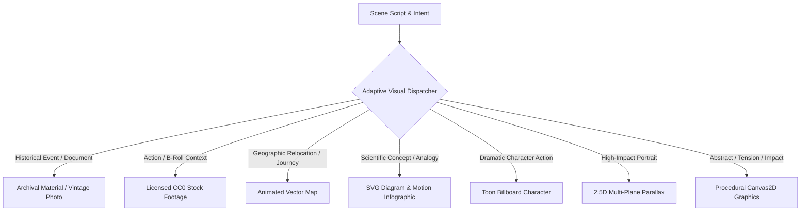
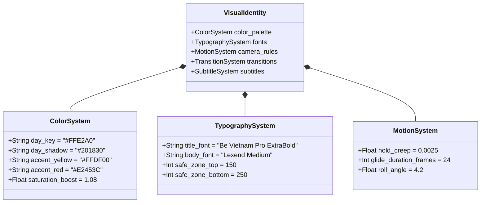

# ADAPTIVE VISUAL ENGINE DESIGN & COHESIVE STYLING SPECIFICATION
**Project:** Zero-Budget AI Video Studio (Vietnamese Shorts)  
**Document ID:** `docs/VISUAL_ENGINE_DESIGN.md`  
**Date:** 2026-11-19  
**Auditor:** Principal Video Production Engineer & Visual Architect  
**Status:** Complete (Phase 0 Design)

---

## 1. The Adaptive Visual Strategy

### 1.1 Architectural Rationale: Why Monolithic Pipelines Fail
Most automated video generators fail for one of two reasons:
1. **The Static Slideshow Trap:** They stitch together generic stock photos with uninspired transitions, resulting in low retention, high bounce rates, and an amateurish aesthetic.
2. **The Monolithic 3D / AI Video Trap:** They attempt to render every scene in a complex 3D WebGL world (like the reference repository's bridge) or generate every frame with heavy diffusion models. On an 8GB Apple M3 MacBook Air, this causes rendering times of 15–30 minutes per short, frequent crashes, and restricts narratives to scenes that can be modeled in 3D.

### 1.2 The Multi-Modal Solution
The **Adaptive Visual Engine** treats visual storytelling adaptively: each scene is assigned the visual method that best communicates its core idea, while a shared visual framework preserves brand identity throughout the short:



---

## 2. Specification of the 10 Visual Modalities

### Modality 1: Real Photographs with Dynamic Ken Burns
* **Source:** High-resolution public domain or CC-BY photography (Wikimedia Commons, Openverse).
* **Processing:** Images are cropped to 9:16 portrait ratio. A dynamic smootherstep camera pans across areas of interest while pushing in by 4%–8% over the scene's duration.
* **Finishing:** Subtle 35mm film grain overlay and gentle edge vignetting to blend seamlessly with motion scenes.

### Modality 2: Legitimately Licensed Stock Footage
* **Source:** Curated CC0 / permissive stock clips (Pexels, Pixabay, Wikimedia Commons).
* **Processing:** Vertical 1080×1920 center-crop, motion stabilized, framerate-conformed to 30 FPS.
* **Color Grading:** Conformed to the studio's Day or Golden Hour color lookup tables (LUT) to prevent abrupt color jumps between scenes.

### Modality 3: Historical Archival Materials
* **Source:** Vintage public domain manuscripts, patents, newspaper clippings, and historical daguerreotypes.
* **Technique:** Treated with a customized duotone or sepia grading pass, animated paper crease overlays, and subtle corner pin rotations imitating physical archival artifacts.

### Modality 4: Vector Maps & Geographical Visualizations
* **Source:** OpenStreetMap / Leaflet / MapLibre vector tile rendering.
* **Technique:** Dynamic vector camera animating from global view to city-level coordinates; animated SVG path drawing for troop movements, voyage routes, or trade corridors; bouncing location pins with pulse rings.

### Modality 5: SVG Vector Illustrations
* **Source:** Algorithmic and procedural SVG assets.
* **Technique:** Animated stroke dashes simulating hand-drawn blueprint sketches; morphing shapes illustrating abstract transformations; zero rasterization blur at 1080×1920 resolution.

### Modality 6: Motion Infographics & Data Visualizations
* **Technique:** Animated numeric counters ticking up to historical statistics (e.g. counting from 0 to 74 soldiers); animated split-screen comparison cards ("Kế hoạch vs Thực tế"); radial progress meters; highlight callout badges.

### Modality 7: Procedural 2D Animation
* **Source:** Pure HTML5 Canvas2D math algorithms.
* **Technique:** Comic-book shockwaves, impact speed lines, dust puffs, drifting smoke particles, falling rain ripples, and tension lightning bursts composited directly into the frame.

### Modality 8: 2.5D Multi-Plane Parallax
* **Technique:** A single high-impact photograph or portrait is segmented into two layers: foreground subject cutout and inpainted background.
* **Motion:** The camera dollies forward; the foreground cutout moves at 1.4× camera velocity while the background scales at 0.8×, creating a striking sense of three-dimensional depth without requiring a 3D mesh.

### Modality 9: Original Character Billboard Animation
* **Source:** Adapted from the reference repository's `toon.ts` `Pen` vector drawing engine.
* **Technique:** Procedurally draws flat 2D cartoon figures (bean heads, stick limbs, cultural attire, expressive eyes) onto dynamic `<canvas>` textures placed on 3D or 2.5D billboard planes with cast shadows and scene lighting.

### Modality 10: AI-Generated Images (Optional / Staged)
* **Status:** Optional fallback.
* **Strategy:** Because running SDXL locally on 8GB RAM is unfeasible, this modality is only invoked if the user configures an external zero-budget generation hook or runs an isolated lightweight LCM-LoRA model when other processes are inactive. If unavailable, the engine gracefully routes to Archival or Procedural modalities.

---

## 3. Cohesive Visual Identity Framework

To ensure that combining disparate visual formats looks like an intentional, high-end documentary rather than a random montage, the studio enforces a strict **Unified Design System**:



### 3.1 Color & Tone Mapping System
* **Day Preset:** Warm golden-yellow directional key light (`#FFE2A0`), cool violet-navy shadow fills (`#201830`), vibrant saturated sky tones.
* **Tension / Golden Preset:** High-contrast backlit amber rim light (`#FFB36B`), deep indigo shadows, peach horizon fog.
* **Unified Post-Processing:** All visual modalities pass through a global Remotion color grading shader applying consistent contrast curves, ensuring stock footage and procedural graphics share the same chromatic signature.

### 3.2 Motion & Camera Language (Measured from Reference Reports)
* **Zero Static Holds:** Every camera hold incorporates a continuous creeping push-in of **0.15% to 0.35% per frame** to prevent the viewer's eye from disengaging.
* **Smootherstep Glides:** Camera movements between focal points use cubic smootherstep curves (`6t^5 - 15t^4 + 10t^3`) lasting 18 to 36 frames, preventing jarring linear stops.
* **Impact Kicks:** On moments of dramatic revelation or physical impact (e.g. a bridge collapse, a gunshot, a sudden fact), the camera undergoes a high-frequency alternating screen-shake decaying over **7 frames** (`[-8px, +6px, -4px, +3px, -2px, +1px, 0]`).

### 3.3 Seamless Transition Protocol
* **Hard Cuts:** Reserved exclusively for radical temporal leaps or dramatic hook reveals.
* **Whip Pans:** Fast 8-frame directional camera transitions accompanied by whoosh SFX for fast-paced sequential actions.
* **White Flash:** 4-frame high-intensity exposure bloom marking the transition from the opening hook into the documentary narrative.
* **Cross-Fades:** 6 to 10 frame smooth cross-dissolves for geographical or historical era shifts.

---

## 4. Subtitle Design & Safe-Zone Rules

In vertical 9:16 video (1080 × 1920), mobile interfaces (like YouTube Shorts titles, channel avatars, like buttons, and comment icons) obscure the top 150px and bottom 280px of the screen.

```
+-----------------------------+ (y = 0)
|       TOP UI SAFE ZONE      | (Avoid headers here)
+-----------------------------+ (y = 150px)
|                             |
|                             |
|      PRIMARY VISUAL FOCUS   | (Faces, maps, key action)
|                             |
|                             |
+-----------------------------+ (y = 1200px)
|   ANIMATED SUBTITLE ZONE    | (y = 1250px - 1450px)
|    [ 74 NGƯỜI LÍNH ]        | (Word-level bounce & highlight)
+-----------------------------+ (y = 1500px)
|      BOTTOM UI SAFE ZONE    | (Obscured by YT Shorts UI)
+-----------------------------+ (y = 1920px)
```

* **Subtitle Geometry:** Centered horizontally (`x = 540`), anchored vertically at `y = 1350px` (70% of frame height).
* **Word Highlighting Animation:** The currently spoken Vietnamese syllable scales up to `1.15x` with an active bright yellow fill (`#FFDF00`), while non-active words in the 3-word cluster remain crisp white (`#FFFFFF`) with a 3.5px dark outline (`#181020`).

---

## 5. Required Technical Distinctions

### Verified Facts
1. The reference repository relies solely on a single Three.js cartoon environment and has no support for real photos, stock footage, maps, or infographics.
2. Canvas2D procedural drawing (`toon.ts`) achieves high visual quality with virtually zero RAM or VRAM penalty.
3. Reference reports (`motion.md`, `lighting.md`, `depth.md`) provide empirical measurements for camera glides, hold creep speeds, and color grading parameters that can be applied to 2D and 2.5D scenes.

### Technical Assumptions
1. Combining diverse visual modalities under a unified color grade and typography system will produce a more engaging educational documentary than a homogeneous 3D cartoon style.
2. Pre-processing and cropping images to 1080×1920 before feeding them to Remotion will keep memory usage under 1.2 GB during rendering.

### Proposed Solutions
1. Build an abstract `SceneRenderer` component in Remotion that dynamically renders the appropriate sub-component (`PhotoScene`, `StockScene`, `MapScene`, `ParallaxScene`, `ToonScene`) based on `manifest.json`.
2. Implement a global Color Grade shader pass across all Remotion compositions.
3. Automate Ken Burns camera keyframing using smootherstep interpolations.

### Known Limitations
1. Fully automated cutout extraction for 2.5D parallax requires an AI segmentation model (such as RMBG or BiRefNet). On 8GB RAM, this must be executed as a lightweight ONNX task or fall back to standard Ken Burns photo panning.
2. Low-bandwidth internet connections will increase asset download latency for high-resolution stock video clips.

### Unresolved Questions
1. Should the user be able to manually override the automatically selected visual method for each scene in the storyboard web editor? (Architectural recommendation: Yes).
