# ZERO-BUDGET ARCHITECTURAL ANALYSIS & COMPLIANCE MATRIX
**Project:** Zero-Budget AI Video Studio (Vietnamese Shorts)  
**Document ID:** `docs/ZERO_BUDGET_ANALYSIS.md`  
**Date:** 2026-11-19  
**Auditor:** Principal Software Architect & Systems Engineer  
**Status:** Complete (Phase 0 Audit)

---

## 1. Zero-Cost Architectural Mandate

In strict accordance with project constraints, zero monetary cost is treated as an immutable architectural requirement. 

The studio architecture forbids:
* Mandatory paid APIs (e.g. OpenAI GPT-4, ElevenLabs, Midjourney, Runway, Kling).
* Subscription tiers or trial credits that silently convert to billable accounts.
* Services requiring credit card or payment information to activate.
* Commercial platforms with restrictive quotas that throttle or lock users out of video exports.

All recommended dependencies must be open-source software, free public datasets, legitimately accessible public APIs, or local offline algorithms.

---

## 2. Pipeline Component Feasibility & Cost Audit

### 2.1 Vietnamese Script Generation & Processing
* **Commercial Baseline:** OpenAI / Anthropic / Google Gemini paid API keys ($0.01 – $0.05 per script).
* **Zero-Budget Solution:** 
  1. *Primary Workflow:* The web application provides a dedicated Script Studio where the user pastes their own Vietnamese script directly. This guarantees 100% free operation with zero API dependency.
  2. *Automated Structuring & Scene Splitting:* Handled locally by a lightweight Python rule-based NLP segmenter (splitting on punctuation, measuring syllable counts, assigning pacing weights) or by an optional local 4-bit quantized model (e.g., Qwen2.5-1.5B via llama.cpp) running locally on Apple Silicon.
* **Cost:** $0.00.
* **Payment Info:** None.

### 2.2 Vietnamese Voice-Over & Text-to-Speech (TTS)
* **Commercial Baseline:** ElevenLabs ($5–$22/month), Google Cloud Text-to-Speech ($16/million characters after free tier), Azure Speech ($16/million characters).
* **Zero-Budget Solution:**
  1. *Option A — Microsoft Edge-TTS (`edge-tts` Python library):*
     * Utilizes the public WebSocket endpoints powering the Microsoft Edge read-aloud service.
     * High-fidelity neural voices: `vi-VN-HoaiMyNeural` (Female) and `vi-VN-NamMinhNeural` (Male).
     * Provides exact millisecond-level word boundaries out-of-the-box.
     * Cost: $0.00. No API key required. No credit card required.
  2. *Option B — macOS Native Speech (`say -v Linh`):*
     * Built into macOS; verified installed on this MacBook Air.
     * 100% offline, zero network latency, zero bandwidth, zero privacy exposure.
     * Cost: $0.00.
  3. *Option C — Piper TTS (Open-Source ONNX):*
     * Fast local neural TTS trained on the open-source Vietnamese VIVOS dataset.
     * Completely local, runs on CPU in <100MB RAM.
     * Cost: $0.00.
* **Verdict:** Edge-TTS as default for broadcast quality; macOS `Linh` and Piper TTS as offline zero-network fallbacks.

### 2.3 Visual Material Discovery & Licensing
* **Commercial Baseline:** Shutterstock, Getty Images, Adobe Stock ($30–$200/month).
* **Zero-Budget Solution:**
  1. *Wikimedia Commons API:* Millions of public domain and Creative Commons (CC0, CC-BY, CC-BY-SA) historical photographs, scientific diagrams, and archival portraits. Unlimited search, zero cost, no API key required.
  2. *Openverse API (formerly Creative Commons Search):* Search index for over 700 million open-licensed cultural and educational images. Completely free.
  3. *Pexels & Pixabay Public APIs:* Permissive platform licenses allowing free commercial and non-commercial video/photo use without royalty fees. Free API keys with generous rate limits (200 requests/hour).
  4. *OpenStreetMap & Overpass API:* High-quality vector geospatial boundaries and tile rendering under the Open Database License (ODbL).
* **Cost:** $0.00.
* **Payment Info:** None.

### 2.4 Character & Procedural Animation
* **Commercial Baseline:** Vyond, Adobe Character Animator, D-ID, HeyGen ($40–$100/month).
* **Zero-Budget Solution:**
  * Inherit and adapt the procedural Canvas2D vector illustration engine (`toon.ts` `Pen` class) from the reference repository.
  * Draws cartoon characters, faces, bean heads, stick limbs, costumes, and props dynamically onto dynamic 2D canvas textures and SVG elements.
  * Consumes zero API calls, generates zero external network traffic, and has zero asset licensing fees.
* **Cost:** $0.00.

### 2.5 Sound Design & Music Scoring
* **Commercial Baseline:** Epidemic Sound, Artlist ($15–$30/month).
* **Zero-Budget Solution:**
  * Adopt the reference repository's pure Python DSP mathematical synthesizer (`dsp.py`, `instruments.py`, `sfx_gen.py`, `mix.py`).
  * Procedurally generates percussion (kick, snare, hi-hat, march drums), risers, drones, snaps, and tension hums via mathematical waveforms (`numpy`, `scipy`).
  * Supplements with verified CC0 / Public Domain sound effects from Freesound and the Free Music Archive.
  * Because audio is generated mathematically by code or sourced from CC0 repositories, there is zero risk of YouTube copyright strikes or monetization claims.
* **Cost:** $0.00.

### 2.6 Video Compositing & Rendering
* **Commercial Baseline:** Adobe Premiere, After Effects, Cloud rendering platforms ($25–$80/month).
* **Zero-Budget Solution:**
  * Remotion (Open source under the Remotion License: free for individuals and companies with up to 3 people or under $1M revenue).
  * FFmpeg (GPL/LGPL open source command-line tool, local hardware encoding via macOS `h264_videotoolbox`).
* **Cost:** $0.00.

---

## 3. Comprehensive Zero-Budget Compliance Matrix

| Studio Subsystem | Technology Selected | Monetary Cost | API Key Required? | Card / Billing Required? | Execution Mode | Licensing Terms | External Data Shared |
| :--- | :--- | :--- | :--- | :--- | :--- | :--- | :--- |
| **User Interface** | React + Vite + Tailwind | **$0.00** | None | No | Localhost | MIT / Open Source | None (Local only) |
| **Backend API** | FastAPI / Python 3.9 | **$0.00** | None | No | Localhost | MIT / Open Source | None (Local only) |
| **Script Segmenter** | Python Rule-Based NLP | **$0.00** | None | No | Local (CPU) | Custom (Studio) | None (Local only) |
| **Voice Synthesis (Primary)** | Microsoft Edge-TTS | **$0.00** | None | No | Cloud WebSocket | Free Public Service | Script text sent to MS |
| **Voice Synthesis (Offline)** | macOS `say -v Linh` | **$0.00** | None | No | Local (macOS) | Apple Built-in | None (Local only) |
| **Word Alignment** | Edge-TTS WS / Whisper Base | **$0.00** | None | No | Local (MPS) / WS | MIT / OpenAI OSS | None (Local only) |
| **Archival Imagery** | Wikimedia Commons API | **$0.00** | None | No | Public REST | CC0 / CC-BY / Public Domain | Search keywords only |
| **Stock Imagery** | Openverse / Pexels API | **$0.00** | Optional Free | No | Public REST | CC-BY / Pexels License | Search keywords only |
| **Geographic Maps** | OpenStreetMap / Leaflet | **$0.00** | None | No | Public / Local | ODbL / Open Source | Lat/Lon coords only |
| **Vector Graphics** | Canvas2D / SVG Procedural | **$0.00** | None | No | Local (CPU/GPU) | MIT / Studio Original | None (Local only) |
| **Audio Synthesis** | Python DSP (`scipy`/`numpy`) | **$0.00** | None | No | Local (CPU) | MIT / Studio Original | None (Local only) |
| **Video Compositing** | Remotion + Three.js | **$0.00** | None | No | Local (Node/Chromium)| Remotion License (Free)| None (Local only) |
| **Video Encoding** | FFmpeg (`h264_videotoolbox`) | **$0.00** | None | No | Local (Apple Silicon)| GPL / LGPL | None (Local only) |
| **Quality Control** | `short_qa.py` (OpenCV/PIL) | **$0.00** | None | No | Local (CPU) | MIT / Studio Original | None (Local only) |

---

## 4. Risk Mitigation & Fallback Strategy for Free Services

```mermaid
graph TD
    subgraph VoiceFallbacks["Voice Generation Fallback"]
        V1["Primary: Edge-TTS (Neural vi-VN)"] -->|If network fails / throttled| V2["Fallback 1: Piper TTS (Local VIVOS ONNX)"]
        V2 -->|If Piper model missing| V3["Fallback 2: macOS Native (say -v Linh)"]
    end

    subgraph AssetFallbacks["Visual Asset Fallback"]
        A1["Primary: Wikimedia Commons / Openverse"] -->|If zero results returned| A2["Fallback 1: OpenStreetMap Vector Tiles"]
        A2 -->|If non-geographical| A3["Fallback 2: Procedural Canvas2D / SVG Illustration"]
    end

    subgraph SoundFallbacks["Sound Design Fallback"]
        S1["Primary: Python Procedural DSP Synthesis"] -->|For organic ambience| S2["Fallback: Bundled CC0 Sound FX Library"]
    end
```

---

## 5. Required Technical Distinctions

### Verified Facts
1. macOS native `say -v Linh` works 100% offline with zero cost, zero API keys, and verified sub-second response times on this machine.
2. The reference repository's Python audio suite (`mix.py`, `dsp.py`, `music.py`, `sfx_gen.py`) is written in standard `numpy` and `scipy`, both of which are already installed on this machine, incurring zero cost.
3. Remotion is free to use for personal projects and small commercial entities under its licensing tier.
4. Wikimedia Commons provides unrestrained access to public domain and Creative Commons media without requiring API keys or account registration.

### Technical Assumptions
1. Edge-TTS endpoints will remain accessible for free non-commercial usage; should endpoint changes occur, local Piper TTS and macOS `say` guarantee uninterrupted offline operation.
2. Pexels and Pixabay free API tiers provide sufficient rate limits (200 requests/hour) for an individual content creator rendering 5–10 shorts per day.

### Proposed Solutions
1. Structure the asset pipeline with strict multi-level fallbacks: Network Public API -> Local Asset Cache -> Procedural Canvas2D Graphics.
2. Automatically record licensing metadata (License Name, Source URL, Creator Name) into the Scene Manifest for every external asset downloaded.

### Known Limitations
1. Fully local AI image generation (e.g., Stable Diffusion) cannot operate reliably on this 8GB machine without exhausting memory and swap; therefore, procedural graphics, archival photos, and stock footage must serve as the primary zero-cost visual modalities.
2. Edge-TTS requires an active internet connection.

### Unresolved Questions
1. Should the web application feature an automated YouTube Shorts uploader via the Google YouTube Data API v3 (free tier, 10,000 units/day), or should video distribution remain strictly local download-only?

---

## 6. Phase 0.5 Re-Validation Addendum (Dependency Permanence & Risk Updates)

* **Microsoft Edge-TTS Downgrade:** Unofficial scraping endpoints broke during Phase 0.5 validation with `HTTP 400 Bad Request`. It is reclassified from a "zero-cost baseline" to a **Fragile / Non-Guaranteed External Service**. It cannot be a mandatory component.
* **macOS Native Speech Promotion:** macOS `say -v Linh` with automated phonetic text normalization is confirmed as the **100% Guaranteed Permanent Zero-Cost Local Baseline**.
* **Pexels / Commercial Stock API Terms:** Reclassified from "permanent free" to **Variable Third-Party Terms**. Wikimedia Commons (Public Domain / CC0) and procedural Canvas2D vector graphics are confirmed as the primary permanent visual foundations.
* See [PHASE_0_5_VALIDATION.md](file:///Users/thienduc/Desktop/Code/ytbshorts/docs/PHASE_0_5_VALIDATION.md) for full compliance matrix updates.
